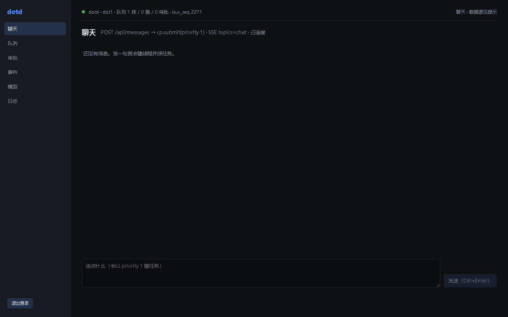
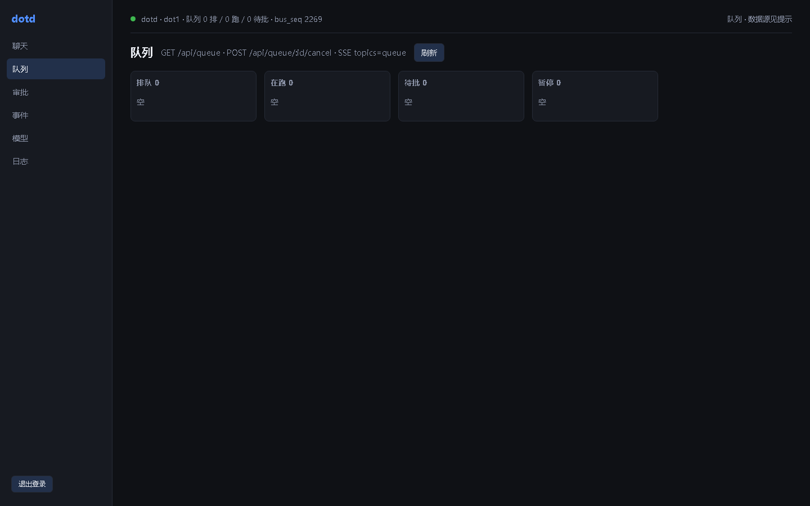
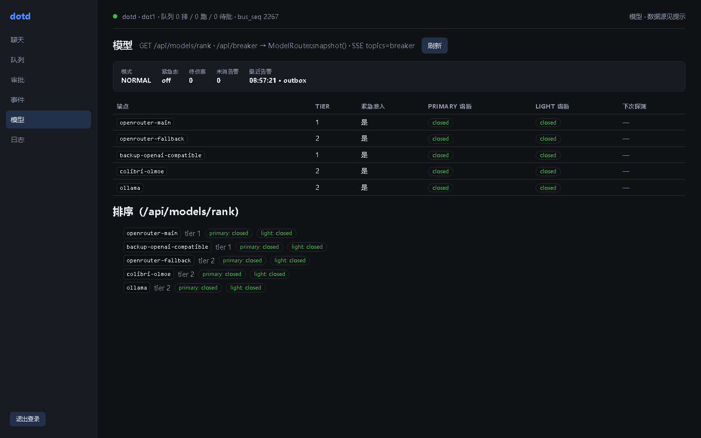

# dotd — Autonomous Dot System

A resident single-process personal AI Agent daemon: TypeScript single process + SQLite + one Playwright container per Dot (`package.json:5`).

**The Chinese README is the authoritative one — see [README.md](README.md).** This file is a shorter, aligned summary.

---

## What this is

dotd is a **resident process**, not a web app. It runs in the background, receives events from four machine ingress points (HTTP webhook / JSONL file / heartbeat scheduler / Feishu) — the JSONL file entry uses `~/dots/inbox/*.jsonl`, defaults to `enabled:false`, and its polling loop is still unwired (`config/dotd.yml:61-65`, see Known Limitations-Low) — turns events into queued tasks, and drives an LLM↔tool loop in a Runner coroutine. The actual work happens inside a Docker container (Playwright + stealth, with a persistent browser-profile volume per identity and a `/dot/home` file-memory volume).

Real entry point is the daemon assembly layer:

```
npm run serve   →   node --import tsx src/daemon.ts        (package.json:15)
npm run dotd    →   node --import tsx src/surfaces/cli.ts  (package.json:14, HTTP thin client)
```

`src/daemon.ts:850-856` finishes assembly and then `await new Promise<void>(() => {})` forever — the event loop is held by the Runner's pop loop (`src/runner/dot.ts:364-372`, 1000ms idle poll), the HTTP server, and scheduler timers. Hence *resident*, not on-demand.

### Who it is for

People who want to own all of their own state: conversation history, task queue, journal, approvals, breaker state and file memory all live under `~/.dotd/` on a machine you control. The design explicitly rejects any commercial managed service; the only permitted external dependency is a model API, and `base_url` is a one-line config change (`config/models.yml`). If you want "vendor account + closed-source service in exchange for persistence", this is not it.

### How it differs from a chatbot

A chatbot is stateless request/response. dotd's unit of work is a **task**: queue position, priority, journal steps, crash-recovery semantics, approval gates. Events can arrive and be executed while nobody is online (heartbeat, Grafana webhook, Feishu message); results are pushed back to the originating conversation over an outbound loop.

Crash safety is **step-level**, not "workflow-step level": `beginTool` writes the `started` row first (`synchronous=FULL`, durable before any external call), `endTool` writes `succeeded`. A result already on disk is never replayed; an unknown side effect is never auto-re-executed.

### How it differs from a workflow engine

Workflow engines run a fixed DAG. dotd tasks are driven by a **natural-language goal**; what happens next is decided by the model at runtime. Event→task matching is two-layer: rules first (`config/event-rules.yml`, confidence 1.0 on hit), model layer second (`track:'light'`, strict JSON parsed once). Confidence ≥0.85 executes directly, 0.55–0.85 executes plus a revocable notification, <0.55 lands in the inbox for the owner.

### Glossary (terms used throughout without further explanation)

| Term | Meaning |
|---|---|
| **Track** | Two quality lanes for a model call: `primary` (strong/paid, interactive tasks) and `light` (cheap/fast, internal chores like event matching, summarization, precheck). Chosen by prefix match against `routing.light_events` in `config/models.yml` (`:83-92`); everything else defaults to primary. **Your `dotd ask` and Feishu messages take the primary track.** |
| **tier1–4** | Endpoint priority layers: tier1 paid/strong (hy3), tier2 local/free backups (OLMoE, Ollama, OpenRouter free), tier3 curated free pool (`config/free-models.yml`, currently empty), tier4 recon candidates discovered at runtime. Failures degrade forward only, never back up. |
| **Breaker / half_open** | A circuit breaker per endpoint×track: closed → open (failure ratio / consecutive failures / auth immediately) → half_open (limited probe once due) → closed (enough probe successes). Persisted across restarts. A primary-track endpoint stuck open = every interactive task stalls. |
| **Journal step** | The action log of a task, one row per step in SQLite: `beginTool` writes `started` first (`synchronous=FULL`), `endTool` writes `succeeded`. Crash recovery reconciles by step; a result already on disk is never replayed. |
| **dot / Dot** | One identity-bearing worker unit: a browser-profile volume + a `/dot/home` file-memory volume + one exec container. Phase 1 has only `dot1`; multi-Dot is phase 3. |
| **WRITE-SEAL** | The memory-seal mechanism: if a task should have written file memory but didn't, the Runner gets one reminder round to write it (`src/memory/seal.ts`), so an agent cannot finish work without leaving a trace. |
| **stub** | An in-memory fake: `DOTD_MODEL_TRANSPORT=stub` replays canned model responses, `DOTD_FLEET=stub` simulates container behavior without starting Docker. The green gate was earned under stubs. |
| **netfuzz** | A libFuzzer load resident in WSL (~20GB RAM + heavy CPU) that the watermark and container-limit designs treat as a neighbor — not a dotd component. |

---

## Current status

**Phase-1 MVP.** One full path works end-to-end — via stubs.

### Gate measurements (2026-10-17, Node v24.13.0 / npm 11.9.0, native Windows)

I ran all three in this session:

| Check | Command | Result |
|---|---|---|
| Typecheck | `node node_modules/typescript/bin/tsc --noEmit -p .` | exit **0**, 0 errors |
| Test suite | `npm test` | `tests 1004 / pass 1004 / fail 0`, exit **0** (48 `.test.ts` files, 92 suites) |
| E2E smoke | `node scripts/smoke.mjs` | **11/11 pass**, exit **0** |

The smoke script builds its own temp data dir and temp `config.yml`, starts a daemon child with stub model / stub fleet, then: `GET /api/status` 200 → `POST /hooks/smoke` 202 → event match creates task `tk_ev_1` and runs it to `done` → journal contains an `fs.write succeeded` step → IPC-triggered graceful shutdown exitCode=0 → `shutdown_marker` persisted → `OUTBOX.md` written (`scripts/smoke.mjs:1-20` header).

### One thing you must know about the test numbers

The `1004/1004` above was produced **from the `dotd/` directory** (`npm test` runs with cwd = repo root). But a gate run recorded 11 failures (`pass 862 / fail 11`, exit 1) — at that time the suite total was 879. Those 11 failures are **all in one class of test**: three files that build repo-internal paths from `process.cwd()` —

- `tests/router-config.test.ts:34` — `join(process.cwd(), 'config', 'models.yml')`, parses the real `models.yml` continuation-line syntax
- `tests/surfaces-channels-web-config.test.ts:432` — `join(process.cwd(), 'config', 'dotd.yml')`, reads the repo's real `dotd.yml`, all seven sections
- `tests/surfaces-cli.test.ts:370` — `join(process.cwd(), 'src', 'surfaces', 'cli.ts')`, reads source to assert the CLI imports no SQLite

I reproduced exactly that failure set by running those three files from `dotd/tests/` (`ENOENT` — no `config/` or `src/` under that cwd). So this is **not a product defect, it is cwd fragility in the test suite**: launched from any directory other than the repo root, those 11 go red. The other 42 test files derive paths from `import.meta.url` and are unaffected.

"All tests green" therefore needs a qualifier: **`npm test` from `dotd/` is 1004/1004**. Don't run it elsewhere, and don't conclude there are 11 real failures.

### What is genuinely verified

- Type system: full `tsc --noEmit` clean.
- Module behavior: 1004 cases covering the control plane (queue / journal / recovery / event matching / scheduler), router degradation and the breaker state machine, governance approval octant-state and tool catalog, exec idempotency ledger and network convergence, memory inject/seal/retention, surfaces HTTP/HMAC/SSE/ingress/Feishu inbound and outbound, and the Runner main loop.
- Container protocol consistency: `tests/agent-runtime-protocol.test.ts` asserts `agent-runtime/protocol.ts` (container-side authority) and `src/exec/protocol.ts` (host side) are byte-identical in shape — 40 cases, including per-tool comparison of the 11-name vocabulary, `args_hash`/`identity_hash` equality, and matching fs error codes.
- Smoke: daemon really starts and stops, event → task → terminal state, journal has a real tool step.

### What is stubbed — do not treat as verified

| Item | Status |
|---|---|
| Model calls | **All stubbed.** Tests use `tests/helpers.ts:120` `makeStubTransport()`; smoke uses `DOTD_MODEL_TRANSPORT=stub` (`scripts/smoke.mjs:154`). Zero network model requests were made; no endpoint in `config/models.yml` was probed. |
| Docker execution plane | **All stubbed.** `DOTD_FLEET=stub` (`scripts/smoke.mjs:156`) and `makeStubFleet()`. The stub runtime's `browser.*` only simulates structure and never launches chromium; `shell.run` returns fixed fake stdout (`src/exec/stub-runtime.ts:12-15,382-397`). |
| Real Feishu link | **Unverified.** No appId/appSecret in the repo; no connection to the open platform this session. WS long-connection dial-in and outbound `sendText` round-trips were never tested. |
| Full Web UI build | **Not run** `npm run build:web`. `web-ui/dist/` is a pre-existing artifact; smoke shows `GET /` and static assets all 200. |
| CLI against a live daemon | The 14 functional subcommands (plus commander's auto `help`) and their options come from reading `src/surfaces/cli.ts:155-438`, not from end-to-end calls against a running daemon. |

In one line: **the green gate was earned under stub model + stub fleet, and proves nothing about real models or real containers.** Nobody knows what you hit on the first real run.

---

## Prerequisites

### Node

`>=24.0.0` is a hard requirement (`package.json:7-9`; the in-container runtime requires the same, `agent-runtime/package.json:7-9`). Measured here: `v24.13.0`, npm `11.9.0`.

Three reasons Node 24 is mandatory (`CONVENTIONS.md:17-21,32,71-72`): ① built-in `node:sqlite` `DatabaseSync` instead of better-sqlite3; ② Node 24's native ESM does not map `.js`→`.ts`, so every import must carry the `.ts` extension; ③ tsx is required, not an optional accelerator.

### Native Windows vs WSL (there is an unresolved contradiction here)

- `CONVENTIONS.md:12` says: runtime = native Windows Node 24, **not WSL**; WSL2 only carries the Docker daemon and Playwright containers.
- But the code's real constraint leans WSL: `src/exec/types.ts:154` hardcodes `dockerSocketPath: '/var/run/docker.sock'` (a Unix socket, unreachable from native Windows node), and `src/daemon.ts:587-589` states verbatim "a real fleet requires the daemon to run inside WSL".

**Conclusion**: stub mode runs anywhere on Windows; real containers require the daemon inside WSL. This machine's Windows has no dockerd.

### Docker and the Playwright image

- Base: `mcr.microsoft.com/playwright:v1.49.1-noble` (`exec-image/Dockerfile:6-7`). Pre-pull in WSL with `bash scripts/wsl-pull-image.sh`.
- Built tag: `dotd/exec:1.49.1-0.1.0` (`src/exec/protocol.ts:483` `imageTag()` + defaults at `src/exec/types.ts:155-156`). The build context is a tar.gz assembled **in memory** by the host daemon, containing only `exec-image/Dockerfile` and `agent-runtime/**`, never written to disk (`src/exec/fleet.ts` `buildContextTar`); if the image is missing at boot, it is built automatically.
- Container network `dotd`, bridge, `enable_icc=false` (`src/exec/types.ts:157`); agent-runtime listens on `0.0.0.0:9223` inside the container; the host calls `http://<containerIP>:9223` with a Bearer token.
- Limits: memory+swap 1536MB, 2 cores, `PidsLimit:512`, `ReadonlyRootfs:true`, `CapDrop:['ALL']` + `CapAdd:['SETUID','SETGID']`, `no-new-privileges:true`, `OomScoreAdj:700` (`src/exec/protocol.ts:492-509`).
- WSL prep chain (all present): `scripts/wsl-pull-image.sh` → `scripts/wsl-install-node24.sh` → `scripts/wsl-fleet-prep.sh` (rsync to `~/dotd` native fs + `npm install`) → `scripts/wsl-build-image.mts` → `scripts/wsl-fleet-boot.mts`.

### Models

Read `config/models.yml`. Four tiers:

| Tier | Endpoint | base_url | Model | Key |
|---|---|---|---|---|
| tier1 (primary) | `openrouter-main` | `http://127.0.0.1:7863/v1` | `hy3` | `WB2API_KEY` |
| tier2 (light) | `colibri-olmoe` | `http://127.0.0.1:8001/v1` | `olmoe-colibri` | none |
| tier2 | `ollama` | `http://127.0.0.1:11434/v1` | `qwen2.5:7b` | none, `enabled:false` |
| tier2 | `openrouter-fallback` | `https://openrouter.ai/api/v1` | `poolside/laguna-s-2.1:free` | `OPENROUTER_API_KEY`, `enabled:false` |
| tier1 | `backup-openai-compatible` | placeholder | — | `BACKUP_API_KEY`, `enabled:false` |
| tier3 | `config/free-models.yml` | — | — | `models: []` **pool empty** |

`:7863` is a local workbuddy2api container (4-account pool) whose upstream is an OpenAI-compatible gateway over Tencent CodeBuddy accounts (open source, MIT, `github.com/Sliverkiss/workbuddy2api`). **How to build it, how to obtain `WB2API_KEY`, and what to do without the container are all written up in [`docs/tier1-endpoint.md`](docs/tier1-endpoint.md).** A missing key is not a startup error (`src/router/transport.ts:402-406` `apiKeyFor()` returns null and the auth header is omitted), but runtime requests fail and enter the breaker window — and tier1 is the only endpoint that can carry the primary track, so when this line breaks every interactive task (`dotd ask`, Feishu messages) stalls. To swap endpoints temporarily: edit tier1's `base_url` / `api_key_env` / `models` lines in `config/models.yml` (hot-reloaded).

`config/models.yml` loads fine with no API keys at all; a missing key only surfaces at runtime.

### Feishu

`config/dotd.yml` **now carries** a `feishu:` section (added 2026-10-17; the schema had defaults all along, so a missing section never rejected startup — the long connection just never dialed). That section's six fields in `~/.dotd/config.yml` (`src/surfaces/config.ts:265-272`): `app_id` / `app_secret` / `owner_chat_id` / `verification_token` / `encrypt_key` / `edit_throttle_ms`.

Inbound is an **outbound long connection (WSClient), not a public URL**: the daemon sits behind NAT listening only on 127.0.0.1, so the app side dials out (`src/surfaces/feishu-ws.ts:1-10`). Assembly gate: a real gateway is built only when both `app_id` and `app_secret` are non-empty, otherwise `NULL_FEISHU_GATEWAY` with `available` permanently false (`src/daemon.ts:694-697`).

`owner_chat_id` unset = the connection is still established but **every inbound message is rejected 403** (fail-closed, `src/surfaces/feishu-inbound.ts:137-140`); supports a comma-separated list of chats.

Env var names: `FEISHU_APP_ID` / `FEISHU_APP_SECRET` / `FEISHU_VERIFICATION_TOKEN` / `FEISHU_ENCRYPT_KEY` / `FEISHU_OWNER_CHAT_ID`. **Exporting them alone does nothing**: the surfaces config is a hand-written `feishu:` section in `~/.dotd/config.yml`, and these names only expand inside `${FEISHU_*}` placeholders you write there (`src/surfaces/config.ts:204-211`). Also, WS inbound **needs no verification token** (auth happens in the app_id/app_secret handshake, `src/surfaces/feishu-ws.ts:1-10`); `verification_token` / `encrypt_key` belong to the HTTP webhook path (`/hooks/feishu`).

### Data directory

Single database `~/.dotd/dotd.db` (`db/conn.ts:25-29`; precedence: explicit argument > `DOTD_DB_PATH` > `~/.dotd/dotd.db`). One connection for the whole process; three PRAGMAs set once by the booter: `journal_mode=WAL` + `synchronous=FULL` + `busy_timeout=5000` (`db/conn.ts:40-42`).

`DOTD_HOME` changes the data root (`src/daemon.ts:113-118`); `OUTBOX.md`, `journal-blobs/`, `exec-tokens/`, `notifications.log` all live under it.

### Environment variables and config (the first wall)

**The code does not read `.env` files.** `grep -rn dotenv` across `src/scripts/tests/db` returns zero hits. The repo now ships a `.env.example` (11402 bytes: the variable list plus how-to-get notes for each), but **no code ever loads it** — it is only a checklist for humans; `.gitignore:21`'s `!.env.example` is whitelisting that real file, not a dead rule. Env vars must be exported into the shell.

There are two ways to generate `~/.dotd/tokens.env`; **the first is recommended** (cross-platform — native Windows needs no Git Bash):

```bash
npm run init-config      # scripts/init-config.mjs: generates config.yml + backfills missing keys in tokens.env
```

It randomly generates `DOTD_MASTER_TOKEN` / `DOTD_RO_TOKEN` / `HOOK_GRAFANA` into `tokens.env`, then generates a filled-in `~/.dotd/config.yml` from the repo template `config/dotd.yml`; it is idempotent and **never touches an existing line** (overwriting = destroying real tokens). The bash version `scripts/setup-dev-env.sh` is equivalent but generates only the first three keys plus a `TG_BOT_TOKEN` placeholder — **not `FEISHU_*` or `WB2API_KEY`** — and those two are non-strictly expanded, so leaving them unset silently turns them into empty strings and Feishu and tier1 quietly stop working.

`~/.dotd/config.yml` (seven surfaces sections) **must exist** or the daemon refuses to start: `loadSurfacesConfig` throws `ConfigError` when the file is unreadable (`src/surfaces/config.ts:359`) and also when `master_token` expands to empty (`:363`, fail-closed). The three placeholders `${DOTD_MASTER_TOKEN}` / `${DOTD_RO_TOKEN}` / `${HOOK_GRAFANA}` are hard-required; `TG_BOT_TOKEN` and all `FEISHU_*` are `strict:false` and optional.

> **Trap**: the repo's `config/dotd.yml` is not the surfaces config — no code loads it (only comments reference it). What is actually read is `~/.dotd/config.yml`, and only its `surfaces:` section (`src/surfaces/config.ts:354`); keys like `data_dir` / `wslconfig_note` / `db` are design notes in that file that the loader never touches — real overrides go through env vars (`DOTD_HOME` / `DOTD_DB_PATH`). `cp config/dotd.yml ~/.dotd/config.yml` works (`scripts/dev-run.sh:16` does exactly that, provided the three `${VAR}` are already in the environment), but editing the repo copy has no effect. Also `expected_user_version` is a dead value (no code reads it); the daemon actually migrates with `expectedVersion: 70` (`src/daemon.ts:413`, 8 migration packages) — the template's value has been corrected to 70 with a note.

---

## Quick start

### 60-second version: start the daemon, watch it finish a task on its own

Four commands, all of them in the repo. This uses the stub model and stub fleet — **zero network requests, no containers** — but the daemon, queue, journal, approvals and HTTP/CLI are all real:

```bash
node --version                        # must be >= 24
npm run init-config                   # writes ~/.dotd/tokens.env + ~/.dotd/config.yml (idempotent)
source ~/.dotd/tokens.env             # PowerShell users: see what the script prints
DOTD_MODEL_TRANSPORT=stub DOTD_FLEET=stub npm run serve
```

With the daemon up, open another shell and watch it work:

```bash
source ~/.dotd/tokens.env
npm run dotd -- ask "help me check what's going on today"   # owner conversation, task enters the queue
npm run dotd -- status                     # queue + breaker + pending approvals
npm run dotd -- task tk_ev_1               # task + journal steps
npm run dotd -- watch                      # live event stream
```

Then open `http://127.0.0.1:7788/`, enter your master token on the login page, and you get six views (Chat / Queue / Approvals / Events / Models / Logs).

The three screenshots below are from a **daemon actually running on this machine** — not mockups, not fixture data. The queue one shows only the status cards: finished task titles are the owner's private history and were deliberately left out.

| Chat | Queue | Models |
| --- | --- | --- |
|  |  |  |

The Models one carries the most information: it draws `GET /api/models/rank` directly as a table — each endpoint's tier, whether it takes traffic, the breaker state of both the `primary` and `light` tracks (`closed` = healthy), and the next probe time. The "ranking" block underneath is the real output of `pickCandidates` after health-based reordering. **The endpoint names and addresses come from your local `config/dotd.yml`, so you will see a different set.**

**In stub mode the task runs to completion and leaves journal steps** (the smoke script asserts `fs.write succeeded`), but the model answers and container execution are fake. For a real model, real containers and real Feishu replies, see §Prerequisites and "5. WSL real-container path" below. Full detail, every switch's traps and the complete CLI subcommand list follow.

---
### 0. Check Node

```bash
node --version     # must be >= 24; here v24.13.0
```

### 1. Generate tokens and start the daemon (stub mode, zero network)

```bash
npm run init-config                    # writes ~/.dotd/tokens.env + ~/.dotd/config.yml (idempotent)
source ~/.dotd/tokens.env              # Git Bash / WSL; for PowerShell see the script's output
DOTD_MODEL_TRANSPORT=stub DOTD_FLEET=stub npm run serve
```

Bash equivalent (same effect, but does not backfill `FEISHU_*` / `WB2API_KEY`):

```bash
bash scripts/setup-dev-env.sh          # writes ~/.dotd/tokens.env (idempotent)
source ~/.dotd/tokens.env
cp config/dotd.yml ~/.dotd/config.yml  # six-section template; the three ${VAR} come from the step above
DOTD_MODEL_TRANSPORT=stub DOTD_FLEET=stub npm run serve
```

`DOTD_MODEL_TRANSPORT=stub` = in-memory stub model (`CONVENTIONS.md:154`); `DOTD_FLEET=stub` = in-memory stub fleet, no containers (`:155`). **The two variables have different defaults — do not assume**: unset `DOTD_MODEL_TRANSPORT` = real HTTP (`src/router/transport.ts:33-35`); unset `DOTD_FLEET` = **still stub** — `DEFAULT_EXEC_CONFIG.fleet = 'stub'` (`src/exec/types.ts:149-150`), and `execConfigFromEnv` only overrides on exactly `'stub'`/`'docker'`, so a typo (`Docker`, `real`) silently falls back to stub (`:188-189`). Real containers require an explicit `DOTD_FLEET=docker`. (`CONVENTIONS.md:157`'s "non-stub or unset = real paths" disagrees with the code for `DOTD_FLEET`; the code wins.)

> Note `npm run dotd -- serve` only prints a hint; it is not the real entry point (`src/surfaces/cli.ts:155-160`).

### 2. Drive it from another shell with the CLI

```bash
source ~/.dotd/tokens.env

npm run dotd -- status              # queue + breaker + pending approvals
npm run dotd -- ask "what's up today"   # start an owner conversation (POST /api/messages, priority=1)
npm run dotd -- approvals           # pending approval list
npm run dotd -- approve 42          # approve (once|remember; deny likewise)
npm run dotd -- watch               # live event stream (SSE /api/stream)
npm run dotd -- events              # CP events, paginated
npm run dotd -- task tk_ev_1        # task + journal steps
npm run dotd -- cancel tk_ev_1      # cancel a task
npm run dotd -- logs                # inbound reject audit (via /api/guard bypass)
npm run dotd -- hook grafana '{"k":1}'   # manually deliver a webhook (secret from DOTD_HOOK_SECRET_GRAFANA, i.e. the HOOK_GRAFANA generated by setup-dev-env.sh)
npm run dotd -- hb list             # heartbeat crontab management
npm run dotd -- sos-test            # SOS channel self-check (telegram unwired in phase 1; reports unavailable honestly)
```

Token precedence: `--token` > `DOTD_MASTER_TOKEN` > `~/.dotd/cli_token` (`src/surfaces/cli.ts:34-45`). Base URL precedence: `--url` > `DOTD_URL` > `127.0.0.1:7788` (`:49-56`). Unreachable daemon exits with code **7**.

> **Why `hook grafana` above instead of `hook smoke`**: `hook <source>` looks up `DOTD_HOOK_SECRET_<SOURCE>` (`src/surfaces/cli.ts:336-341`), and the `smoke` source fails twice over — ① `DOTD_HOOK_SECRET_SMOKE` is generated by neither `scripts/setup-dev-env.sh` nor registered in `.env.example`, so the CLI exits 2 with "missing hook secret"; ② even with a secret set, the daemon answers 401 "unregistered hook source: smoke", because `config/dotd.yml:56-60` registers only `grafana` (`src/surfaces/http.ts:788-792`). To use a smoke source, add your own entry under `hooks:` in `~/.dotd/config.yml` with a secret.

### 3. Browser

Open `http://127.0.0.1:7788/` and enter the master token on the login page. Six views: Chat / Queue / Approvals / Events / Models / Logs. HTTP is the system's only listener (`src/surfaces/http.ts:4-5`); a non-7788 port only warns, but an empty `master_token` is a `ConfigError` that refuses startup (`:919-929`).

### 4. Run the gates

```bash
npm run typecheck                  # tsc --noEmit -p .
npm test                           # 1004 cases — always run from dotd/
node scripts/smoke.mjs             # 11/11 E2E smoke (own temp data dir, never touches ~/.dotd)
npm run build:web                  # web-ui: tsc --noEmit + vite build
```

### 5. WSL real-container path (optional)

```bash
# Inside WSL Ubuntu-24.04:
bash scripts/wsl-pull-image.sh     # docker pull mcr.microsoft.com/playwright:v1.49.1-noble
bash scripts/wsl-install-node24.sh
bash scripts/wsl-fleet-prep.sh     # rsync repo to ~/dotd + npm install
# Then build the image and verify a real container boot + fsOps write + docker exec read-back
# through the production code path:
npx tsx scripts/wsl-build-image.mts
npx tsx scripts/wsl-fleet-boot.mts
```

Under WSL, Windows-side loopback model services need `scripts/win-relay.mts` to relay (under WSL2 NAT, WSL's 127.0.0.1 is a separate namespace and cannot reach Windows loopback), launcher `scripts/start-relay.ps1`. The script currently relays only two: `:13065`→`127.0.0.1:3065` and `:18001`→`127.0.0.1:8001` (`scripts/win-relay.mts:3-4,69-70`). **Note that tier1's live port is not relayed**: the Agent2API proxy behind `:3065` is retired, tier1's current proxy is workbuddy2api on `:7863` (`config/models.yml:19-21`), and no `7863` relay rule exists anywhere in `scripts/` (`grep -rn "7863" scripts/` returns nothing). Before running the primary track inside WSL, add your own rule (e.g. `listen(13066, 7863)`) to `win-relay.mts` and point tier1's `base_url` in `config/models.yml` at the relayed address. Native Windows deployments do not need it (daemon and model services share the Windows loopback).

---

## Architecture

`src/` holds eight module directories plus two assembly-layer root files (`src/daemon.ts`, and `src/event-rules.ts` for the side loader).

| Module | Directory | Responsibility |
|---|---|---|
| Control plane CP | `src/control-plane/` | Persistent queue, backpressure watermark, journal steps, restart recovery, event→target matching, **the daemon's only periodic-task host** |
| Model router MR | `src/router/` | tier1→4 one-way degradation, breaker, mode state machine, tier3 pool, SOS/recon. Sole facade `src/router/ModelRouter.ts` |
| Governance GOV | `src/governance/` | Five-tier tool catalog, approval octant-state machine, pre/post-execution review, quarantine, audit, memory rules |
| Execution EX | `src/exec/` | Container fleet state machine, image build, HTTP RuntimeClient, stub runtime, home-path guardrail, network control, disk reclamation |
| Memory MEM | `src/memory/` | Conversation threads, injection rebuild, WRITE-SEAL, retention capacity, OUTBOX guard, fsops bridge |
| Runner | `src/runner/` | The Dot main loop: LLM↔tool coroutine. Builds no Docker, sends no HTTP, never writes tasks/steps tables directly — everything goes through four injected service faces |
| Surfaces SF | `src/surfaces/` | HTTP routing + auth, ingress normalization, SSE, Web UI static hosting, outbound notification channels, Feishu, heartbeat tick |
| Shared | `src/shared/` | Cross-module contracts (`contracts.ts` type surface), event bus, error classes, IDs |

Assembly order (`src/daemon.ts:394-403` header, implemented line by line): openDb+migrate → EventBus+SseBus → createControlPlane → ModelRouter.load → loadCatalog+initGovernance → new ExecServiceImpl+boot → createMemoryService → startHttpServer → startFeishuWs → startFeishuOutbound → new DotRunner → cp.recover → scheduler.start → runner.start (resident).

**Cyclic dependencies are broken with lazy holders**: CP's lowBrain/exec/governance/sealTask are initialized after CP, so memHolder/execHolder/govHolder/routerHolder are created and CP reads them only at runtime through closures, backfilled once MR/GOV/EX are ready (`src/daemon.ts:459-462,513-545`).

### Why that 11-tool contract exists

The closed vocabulary has 11 names (`src/shared/contracts.ts:610-621`, shape-identical to `src/exec/protocol.ts:96`'s `CAPABILITY_CATALOG`):

```
fs.read  fs.write  fs.list  fs.stat  shell.run
browser.open  browser.act  browser.snapshot  browser.close
net.get  net.post
```

Three reasons:

1. **Whitelist = safe default.** Unregistered tools are denied outright: `validateToolCall` returns `unknown_tool` for anything outside the catalog (`src/exec/protocol.ts:257-264`). Governance's `config/tools.yml` registrations must be a subset of this set (`:195-196`) — the file has exactly 11 registered names (lines 21–52) plus one commented example `shop.checkout` (line 60).
2. **It is the only interface between host and container.** `agent-runtime/protocol.ts` (container side) and `src/exec/protocol.ts` (host side) are mirror copies, with the container side as the listening authority (`agent-runtime/protocol.ts:11-16`, "this file must be shape-identical to it"). Drift prevention lives in `tests/agent-runtime-protocol.test.ts`: type-level bidirectional assignment assertions plus runtime comparison of `name/mode/sideEffect`, guard constants, `args_hash`/`identity_hash` equality, and matching fs error codes.
3. **Governance tiers by tool.** Five tiers read / write_file / browser / spend / dangerous: read and write_file default to allow, browser to review, spend to approve (always human), dangerous to approve + Web checkbox confirmation. `rules.yml` can only tighten, never loosen. Sync tools have a hard 60s deadline cap.

### The router's degradation chain

tier1 → tier2 → tier3 → tier4 is **one-way**: failures always degrade forward and never retry upward (`src/router/ModelRouter.ts:437-440`). Within a tier, declaration order is preserved; within tier3, newer `lastVerifiedAt` first. Per-item budget ≤ remaining/2; default track budgets are primary 300s / light 60s.

The breaker is one instance per endpoint×track and persists across restarts: closed → open (window failure ratio ≥0.5 with ≥5 samples / 3 consecutive failures / auth or quota immediately) → half_open (`next_probe_at` due) → closed (≥2 half-open successes). Any half-open failure returns to open; backoff doubles up to 1h. Auth-class faults never auto-recover and get the 1h ceiling.

Global mode has five levels: NORMAL / LOCAL_FALLBACK / EMERGENCY / RESTRICTED / TOTAL_OUTAGE. Under LOCAL_FALLBACK the primary track **refuses by default** to degrade to a local 7B unless `models.yml` explicitly grants tier2 `models.primary` (then `degraded=true` is logged).

Four periodic jobs are registered on CP `registerInternalJob` (contract J4): `breaker.probe_timer` every 60s for synthetic half-open probes (light track only, 8-token ping), `router.janitor` daily, `recon.scan` every 6h and only when not NORMAL, `pool.probe.<id>` every 30min.

---

## Known limitations

Ordered by severity. Everything marked **high** is "you will hit a wall on the first real run" class.

### High

- **The real path has never been verified.** All 1004 tests and the 11/11 smoke run pass under `DOTD_MODEL_TRANSPORT=stub` + `DOTD_FLEET=stub`.
- **`npm test` used to be a false green (fixed 2026-10-17).** The script was `--test "tests/*.test.ts"`; the quotes stopped the glob from expanding, so `--test` received a literal filename, found no file, and did not complain — `tests 0 / pass 0 / fail 0`, exit **0**. Before the fix `npm test` was "all green" for everyone, CI included. It is now unquoted, and pinned to `--test-concurrency=1` (see the next item for why).
- **Three false failures when tests run in parallel (fixed 2026-10-17; not a code defect).** `node --test` runs files in parallel by default. Under a parallel full run, three 429-cooldown scoring cases in `tests/router-health.test.ts` failed consistently (`cooldownRemainingMs` read 0, expected 7500). That file alone passes 25/25, the serial full run passes, and an isolated probe replaying the same settle sequence on a fresh db gives `remaining = 7500 / factor = 0.5` — exactly what the assertions expect. It is shared state under runner concurrency, not a `Breaker`/`HealthTracker` bug. `npm test` now runs serially.
- **The CLI entry guard was permanently false on non-ASCII paths (fixed 2026-10-17).** The old check compared `import.meta.url` against a hand-built `file://${argv[1]}`, but `import.meta.url` percent-encodes non-ASCII path segments (`%E7%A0%94%E7%A9%B6` = "研究") while the hand-built string does not, so they could never match. The guard was always false, so `node src/surfaces/cli.ts status` exited silently with exit 0 and no output. **Every `npm run dotd -- xxx` example in the README was therefore a no-op.** It now uses the same technique as `src/daemon.ts` (compare resolved absolute paths); after the fix `--help` lists all 15 subcommands.
- **A second daemon instance does not consume the queue.** Start one with `DOTD_CONFIG` pointing at another config on a different port (e.g. `:7799`) and `/api/status` works and tasks submit, but they stay `queued` forever — exec marks dot1 `quarantined` at boot (log line `[exec] boot 告警：dot1 进入 quarantined`), so there is no consumer. Check this first when a task will not move. The tier1 proxy's hy3 (`:7863`) tool_calls, breaker open→half_open probing, real container boot/recreate, the `/fs/ops` bridge, and netguard iptables were only ever exercised over stubs.
- **The tier1 primary lifeline is undocumented.** The `:7863` workbuddy2api container and `WB2API_KEY` have zero repo documentation, yet tier1 is the only endpoint that can carry the primary track (all other primary endpoints are `enabled:false`, tier2 carries light only, tier3 pool is empty). Missing key → no auth header → request failure → breaker open → every interactive task (`dotd ask`, Feishu messages) stalls.
- **tier1's `WB2API_KEY` has no persistent source anywhere on this machine (a real gap, not a doc omission).** The build recipe now lives in [`docs/tier1-endpoint.md`](docs/tier1-endpoint.md), but a 2026-10-17 trace found the key in neither `~/.dotd/tokens.env` (read line by line) nor the Windows user/machine environment (`HKCU:\Environment` and the Machine scope both lack it) — it exists only in the currently running daemon's process environment (`/proc/<pid>/environ` shows a value), i.e. the launching shell exported it transiently. Consequence: restarting the daemon via `scripts/daemon-launch.sh` loses the key (that script only `source`s tokens.env), so tier1 dies entirely on restart, with the symptom "daemon starts fine, no task ever completes". Fix: add `export WB2API_KEY=...` to `~/.dotd/tokens.env`.
- **`.env.example` and `scripts/setup-dev-env.sh` overwrite each other, and it does not cover every variable.** The code indeed never reads `.env`; env vars must be exported. The repo now ships `.env.example` (11402 bytes, see "Environment variables and config"), but with three traps: ① it suggests `cp .env.example ~/.dotd/tokens.env`, while `scripts/setup-dev-env.sh` skips when tokens.env already exists — a user who generated real tokens per the quick start and then copies the example over them gets `__REPLACE_ME_*__` placeholders, and the next start fails with `ConfigError「environment variable DOTD_MASTER_TOKEN is not set」` (`src/surfaces/config.ts:204-211`, unset/empty is rejected) with no hint that an overwrite caused it; ② it does not register `DOTD_HOOK_SECRET_SMOKE` (needed by CLI `hook smoke`, while the daemon has no smoke source registered at all — see the quick-start note); ③ every other variable the quick start actually uses is covered. **The cross-platform replacement is `npm run init-config`** (`scripts/init-config.mjs`): it generates `~/.dotd/config.yml` and backfills missing keys in `tokens.env`, is idempotent, and never overwrites existing lines.
- **Two authoritative statements about native Windows vs WSL contradict each other.** `CONVENTIONS.md:12` says "not WSL"; `docs/design/CONTEXT.md:34` says "the control-plane daemon runs inside WSL" (that file is **in the repo** now — see Related documents). By CONVENTIONS' own arbitration rule (design docs win on conflict) the latter applies, and the code's real constraint leans the same way (`src/exec/types.ts:154` hardcodes a Unix socket). Running a real fleet on native Windows only yields `docker unavailable — degraded startup`, after which every container action is rejected.
- **The first human-login channel is entirely undesigned.** There is no display-forwarding path into the container and no identity/login page in surfaces. To make it work with your accounts you must manually copy a logged-in Chrome profile from the host into the docker volume.
- **The state-volume setuid secret-isolation scheme is untested.** Isolation between shell(uid 1001) and runtime(uid 1000) depends on in-container `CAP_SETUID`, but the container already runs as `USER=dot` with reduced privileges. The docs state plainly: "if this fails, shell/secret isolation collapses entirely".
- **Watchdog timeout blind spot.** heartbeat is only written at step end and is static mid-step, so the 180s threshold necessarily misreclaims (that value lives at `src/control-plane/types.ts:189` `heartbeatTimeoutMs: 180_000`); the "transitional 1860s" figure comes from design-time discussion and has **no constant in the repo** (a repo-wide grep for `1860` matches only this line) — background only. How long a genuinely wedged coroutine occupies `maxRunning=1` (`src/control-plane/types.ts:187`) depends on the value actually in force.
- **Cron starvation window is unarbitrated.** Under the approval TTL(24h) (`src/governance/config.ts:44`) × `run_at` × `maxRunning=1` (`src/control-plane/types.ts:187`), one queued high-priority conversation task can starve due heartbeat jobs, and after expiry new ones keep being jumped — heartbeat fails silently. The argument comes from design-time discussion; the repo holds no arbitration record or regression test for it.

### Medium

- **`IMPLEMENTATION.md` was more than a day out of date.** It claimed `exec-image/Dockerfile` does not exist (it is 2626 bytes in the repo), that `scripts/` holds only smoke.mjs (15 non-temporary scripts; 28 entries including `tmp-*` probes), tests 37 (actually 42), test 807 (actually 935), journal-blobs 50 (actually 93) — all stale. It also **never mentioned the Feishu channel** (grep: 0 hits), which is currently the only IM surface that runs end-to-end. **Revised 2026-10-17** (a revision table heads the file); paragraphs without a 2026-10-17 marker are still phase-1 original text.
- **There is no surfaces `config.yml` under `config/` (only the same-named, differently-purposed `dotd.yml`).** `npm run serve` crashes on step one: `loadSurfacesConfig` only reads `~/.dotd/config.yml` (`src/surfaces/config.ts:354`), and no code auto-loads the repo's `config/dotd.yml`. **Fixed 2026-10-17** by the generation entry point `npm run init-config` (`scripts/init-config.mjs`): it fills `~/.dotd/config.yml` from that template and backfills missing keys in `tokens.env`, idempotently and never overwriting an existing line. What remains is the "same name" problem itself (next item).
- **`config/dotd.yml` is a same-name trap.** It carries `dotdReserveMb`/`maxQueued` and the seven surfaces sections, but no code loads it; what is actually read is `~/.dotd/config.yml`. Two same-name files, only one effective; editing the repo copy has no effect.
- ~~**`config/dotd.yml` has no `feishu:` section.**~~ **Fixed 2026-10-17**: the template now carries the six `feishu:` fields (`app_id` / `app_secret` / `owner_chat_id` / `verification_token` / `encrypt_key` / `edit_throttle_ms`), and `init-config` fills them in. Note that `verification_token` / `encrypt_key` only matter for the HTTP webhook path — WS long-connection inbound does not validate them.
- **Five top-level keys of `config/dotd.yml` are read by no code** (`data_dir`/`maxQueued`/`node_max_old_space_mb`/`wslconfig_note`/`db.expected_user_version`); assembly only regex-scrapes the `dotdReserveMb` scalar. Edits take effect silently nowhere.
- **Three CLI subcommands have built-in "route pending" collapses.** `logs` can only go through the `/api/guard` bypass (`src/surfaces/cli.ts:297-309`), and `task` can only `find` inside `/api/queue`, returning `not_found` + a note when absent (`:311-322`); the HTTP route table indeed has no `/api/logs` or `/api/tasks/:id` (`src/surfaces/http.ts:95-135`).
- **Backpressure design depends on two unmeasured environment facts**: WSL2 `docker pause` availability (cgroup-freezer), and the exact location of the netfuzz load (docs assume inside WSL, while `CONTEXT.md:35` allows the opposite). If netfuzz runs outside WSL, all four watermark thresholds are wrong.
- **Phase-1 SOS has only `~/.dotd/OUTBOX.md`**, with nowhere to write when the daemon crashes. A total model outage at 3am may be seen by nobody.
- **Free-pool keys share the primary channel's failure mode.** When OpenRouter goes down, groq `:free` needs the same vendor's key, so Tier3 fails alongside tier1 — the third rung of the resilience chain may exist in name only.
- **OLMoE 7B tool-calling capability is unmeasured**, yet the light track must absorb event.match / summarization / precheck. If it cannot emit strict JSON reliably, event matching dumps into the inbox and the system feels "not autonomous".
- **`calibrate-watermark.sh` does not exist** (watermark calibration is DiskGardener's free<5GB trigger); neither do `wsl-bootstrap.sh` or `portproxy.ps1` — only differently-named equivalents `wsl-fleet-prep.sh` / `win-relay.mts`.
- ~~**17 `tmp-*` / `.tmp-*` probe scripts are now covered by `.gitignore`** (`.gitignore:39-41`: `/tmp-feishu-chats.sh`, `.tmp-*`, `scripts/tmp-*` — exactly the 3 in the root + 14 in `scripts/`; block added 2026-10-17). They still sit in the working tree: no secrets inside, but they hardcode `/root/.dotd` paths, WSL intranet IPs and full systemd unit files — worth deleting before clone/distribution. The accidental `nul` file (cmd redirection artifact) is also ignored.~~ **Deleted 2026-10-17**: it was actually **21** files (4 in the root — `tmp-feishu-chats.sh`, `.tmp-net-probe.sh`, `.tmp-q.sh`, `nul`; 17 `tmp-*` in `scripts/`). Each was backed up byte-for-byte outside the repo first (`%LOCALAPPDATA%\Temp\dotd-tmp-probes-backup-20261017\`), and they were verified to hold no secrets and to have no test/source references. The `.gitignore` probe block stays as the naming convention for future probes (`.tmp-*` or `scripts/tmp-*` is ignored automatically).
- ~~**The `.zcode/` directory (286K, 16 files) has no root-level ignore rule**, blocked only by a `*` inside two nested `.gitignore` files. That protection is brittle.~~ **Fixed 2026-10-17**: `.gitignore` now ends with a root-level `/.zcode/` rule, so it no longer depends on a `*` in a nested file.
- **Several diagnostic scripts under `tools/` carry intranet-IP defaults, and many use absolute `/root/.dotd` paths.** `172.19.0.2:9223` (`tools/probe-async.sh`, `tools/probe-sync.sh`) and `172.17.48.1:13065` (`tools/diag-breaker.sh`) were **made overridable defaults on 2026-10-17**: `export RUNTIME_HOST=127.0.0.1 RUNTIME_PORT=9223` / `RELAY_HOST=<your gateway>` changes the environment without editing the script. Three sites are deliberately left alone: `172.18.0.x` in `src/exec/netguard.ts:89-90` and `src/exec/fleet.ts:1373` is a **functional default** for the docker bridge subnet (changing it makes netguard block the wrong targets), and `scripts/win-relay.mts:24` is a comment recording that a disallowed Host header kept the warm gate from ever going warm. The `/root/.dotd` paths spread across several scripts/tools were not touched — those scripts only ever run on the WSL dev box.

### Low (recorded for completeness)

- `assertProtocolDrift()`, mentioned at `agent-runtime/protocol.ts:16`, has no definition anywhere in the repo (it appears only in that comment); drift prevention is carried entirely by tests.
- Four files named in the design directory tree do not exist: `src/governance/cron.ts`, `src/governance/channels/telegram.ts`, `src/memory/compaction.ts`, `src/surfaces/telegram/` (their functions were merged into other files; anyone following the tree will not find them).
- The Web UI's Settings view has no backend, and hooks online editing is a fixed 501 (`src/surfaces/http.ts:684-685`); `web-ui/package.json:5`'s description still reads "placeholder skeleton" (the content is 1836 lines, filled in — measured 2026-10-17 with `find web-ui/src -type f | xargs wc -l`; the number grows with edits).
- The `jsonl_watch` file-polling loop is unwired and defaults to `enabled:false` (normalization/dedup/rotation semantics are implemented and tested in `src/surfaces/ingress.ts`).
- `journal-blobs/` has accumulated 89 `.json` files (measured this session with `ls journal-blobs/*.json | wc -l`; the count grows with every test run) and keeps growing (gitignored, not committed).
- Migration `000_control_plane.sql:10`'s `events.source` CHECK lacks `'feishu'`, while `src/surfaces/feishu-inbound.ts:271` really writes that value — code stepping over a frozen DDL.

---

## Roadmap

### Phase 2 (interfaces are frozen in phase 1; this is mostly wiring and tuning)

1. **Telegram in full**: getUpdates long-polling, dual approval channel, batched card throttling.
2. **Email ingress**: IMAP/SMTP adapter + attachment policy.
3. **Low-intelligence track in earnest**: Colibrì/Ollama absorbing event.match / summarization / precheck, with an unreliable-local → probe → degrade-again loop.
4. **Free pool + recon + SOS closed loop**: `pool.probe` 30min, tool_roundtrip qualification, `recon.scan` 6h using only `api.github.com`/openrouter metadata, candidate approval cards, Telegram-first SOS chain.
5. **Approval rule persistence**: `approve_remember` derives `endpoint_grants`/`approval_rules` + preview + LRU + a memory page.
6. **Email fallback channel**: SMTP owned by surfaces.
7. **Review degradation matrix tuning**: `reviewDegraded` breaker thresholds, batched card merging, postReview sniffing regex set.
8. **JSONL watch on by default**.
9. **Scheduled turns enhancements**: finer quiet_hours, catch-up dispatch policy.

### Phase 3

- **Multi-Dot**: dots master table + quota bucketing + cross-Dot identity routing + profile-volume affinity.
- **invisible_playwright anti-detection enhancement**: replace the stealth injection implementation, protocol unchanged.
- **Voice** (explicitly last).
- Accompanying mechanism upgrades: merge "interrupt now" channel, conditional enforcement attached to notes, `dotd notes backup`, web session key enabling thread idempotency, least-privilege docker.sock proxy.

---

## License

Apache License 2.0 — see [LICENSE](LICENSE).

## Related documents

- `CONVENTIONS.md` — the single authority for repo-wide conventions (module boundaries, stub variables, database rules).
- `IMPLEMENTATION.md` — implementation report. Revised 2026-10-17 (a revision table heads the file); paragraphs without a 2026-10-17 marker are still phase-1 original text and their numbers may have moved.
- `docs/tier1-endpoint.md` — the tier1 primary endpoint (`:7863` workbuddy2api): how to build it, how to get `WB2API_KEY`, and what to do without the container.
- **The design docs are now in this repo** (`docs/design/`, moved in from one level up on 2026-10-17): `CONTEXT.md`, `自主Dot系统设计方案.md`, six modules plus the seam contracts under `modules/` — 9 markdown files, about 541K. **The "why is it like this" answers are now visible to anyone who clones**, and no `docs/design/...` reference in this file is dangling any more. This used to be the single biggest distribution gap: anyone holding only `dotd/` could not resolve a single design reference. Same files, new location.
